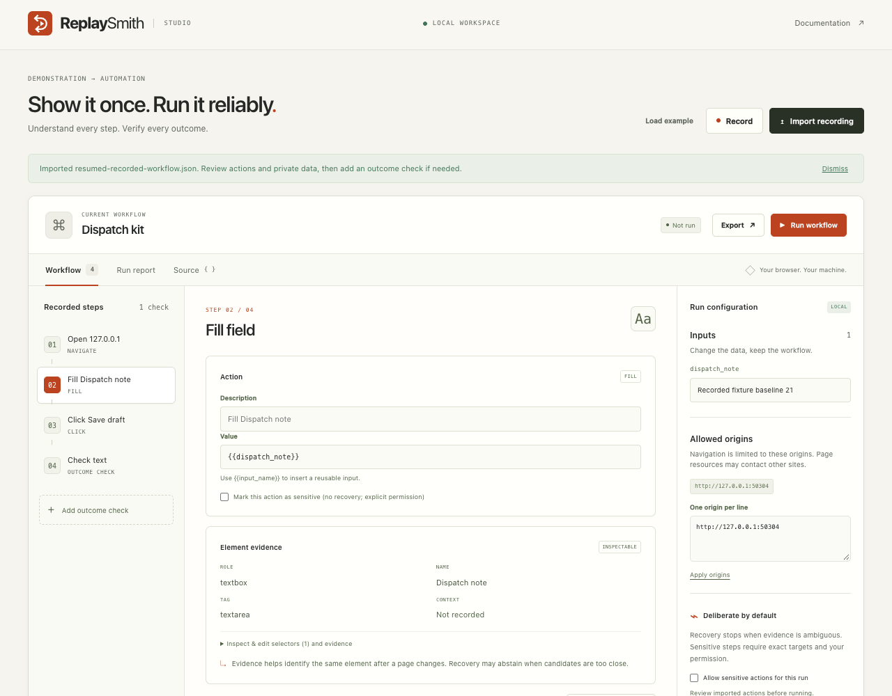
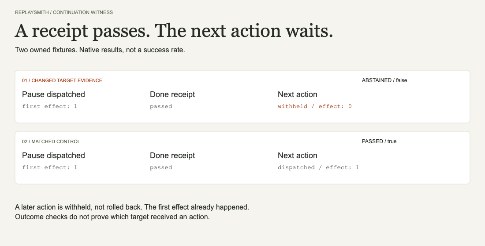
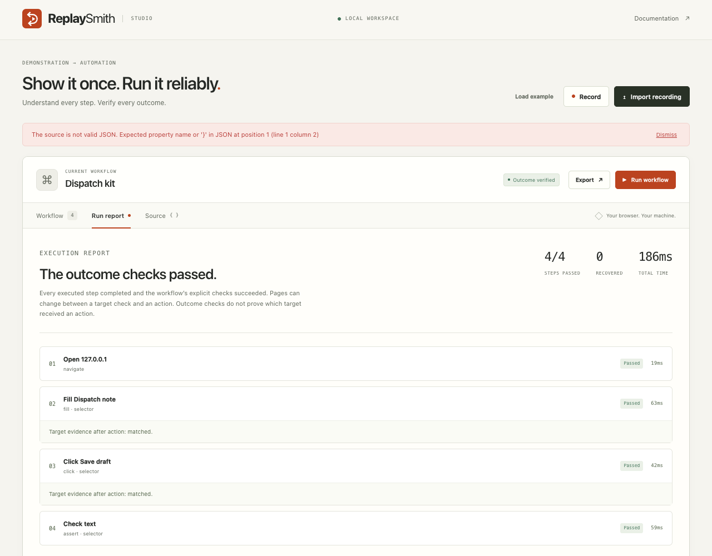

# ReplaySmith

**Record a browser task. Replay it with a checked outcome.**

Build an editable workflow from a demonstration or Chrome DevTools Recorder file. Change its inputs, inspect target recovery, check the result, then export the same behavior as Playwright code or an Agent Skill. Runs locally with Chromium, without a model or API key.



## A receipt passes. The next action waits.

In the [owned continuation witness](docs/presentation/README.md), clicking **Pause** changes its target evidence and produces a **Done** receipt. The read-only receipt check passes, but ReplaySmith withholds **Next**. The matched control continues. The first effect already happened in both cases. This is a boundary demonstration, not a success rate or proof of identity at dispatch.

<picture>
  <source media="(max-width: 600px)" srcset="docs/presentation/continuation-mobile.png">
  
</picture>

[Reports and fixture](docs/presentation/README.md) · [Portable worked bundle](docs/presentation/worked-example.zip) · [Actual Studio report](docs/presentation/studio-desktop.png) · [Phone report](docs/presentation/studio-phone.png)

## Try the source preview

This checkout is **0.1.2-dev.0**, an unreleased source preview. The existing published package is [v0.1.1](https://github.com/nazeeh111/ReplaySmith/releases/tag/v0.1.1); that release and its benchmark packet are separate artifacts.

Requires **Node.js 22 or later**.

```sh
git clone https://github.com/nazeeh111/ReplaySmith.git
cd ReplaySmith
npm ci
npx playwright install chromium
npm run studio
```

Open the printed loopback URL. The built-in example opens a real local form: change the **note** input and choose **Run workflow**. The report distinguishes completed actions from a verified outcome. On Linux, use Playwright's `--with-deps` browser installation option if it reports missing system libraries.

## Demonstration to reusable workflow

1. **Record or import.** Record a task in a fresh browser, or import supported Chrome Recorder JSON. Captured form values become named input defaults.
2. **Edit and check.** Inspect steps, targets and origins. Change inputs per run. Add an explicit outcome check for text, visibility, URL, field value, or native checkbox/radio state. A field-value check can intentionally expect an empty string.
3. **Run and inspect.** Review the action results, recovery evidence and final checks. Missing, ambiguous or conflicting evidence can cause abstention. A failed outcome does not automatically repeat the preceding action.
4. **Export.** Download workflow JSON, a standalone Playwright script, or an Agent Skill ZIP. Executable exports retain the resolver, admission checks, continuation barrier and outcome checks.

Runtime input overrides remain separate from the recorded defaults. Review both before sharing a workflow. Output paths must be new; the CLI refuses existing files.

## Use the CLI

With the studio on its default port 3333:

```sh
node dist/cli.js example -o dispatch.json
node dist/cli.js run dispatch.json --input note='Send the calibration kit to Avery.' --report run.json
node dist/cli.js inspect dispatch.json
node dist/cli.js export dispatch.json --format playwright -o workflow.mjs
node dist/cli.js export dispatch.json --format skill -o exported-skills
```

For another studio port, pass its printed origin to `example --origin`. Import recordings with `import recording.json -o task.json`, or use `record <url> -o task.json` to demonstrate directly. Secret runtime values can use `--inputs-stdin`; the [full guide](https://github.com/nazeeh111/ReplaySmith/blob/main/TECHNICAL_GUIDE.md) covers supported options and formats.

| Run exit | Meaning |
| --- | --- |
| `0` | Explicit outcome checks passed |
| `2` | Abstained or outcome unverified |
| `1` | Failed step, invalid input or output-path error |



[Mobile editor](assets/source-preview/workflow-mobile.png) · [Capture details](assets/source-preview/CAPTURES.md)

## What the checks mean

A checked outcome does **not** establish which target received an action. Target checks and native browser dispatch are separate operations; a page can change between them. Changed or unobservable evidence after an action stops the next action for inspection, while read-only outcome checks may continue.

Marked or detected sensitive steps require permission and an exact recorded selector, and do not use recovery. Sensitive detection is an aid, not a complete classifier. Origin lists constrain navigation, not every page resource or network request. Workflows are executable instructions: inspect them before running them.

Choose **Cancel run** to stop a pending Studio request while keeping the workflow. The studio also cancels pending runs when their request disconnects or the server closes. Already dispatched actions may have occurred; cancellation is not a rollback or an atomic target-identity guarantee.

## Verification and technical detail

See [VERIFICATION.md](VERIFICATION.md) for the source, package, native studio, recorder and independently observed local-save checks, including failed and incomplete probes. The original technical guide, recorded benchmark data, prior live-site reports and media remain preserved. They retain their original scope and do not become measurements of this preview.

The resolver uses deterministic evidence weights, not learned probabilities. Its recorded threshold and margin, supported mutations, benchmark limitations and prior-art comparisons are in the [technical guide](https://github.com/nazeeh111/ReplaySmith/blob/main/TECHNICAL_GUIDE.md), [workflow documentation](https://github.com/nazeeh111/ReplaySmith/blob/main/docs/workflows.md) and [core boundaries](https://github.com/nazeeh111/ReplaySmith/blob/main/docs/core-notes.md).

Chromium and one-page workflows are supported. Frames, multiple tabs, file transfers, drag-and-drop and arbitrary imported JavaScript are outside this version's scope. See [SECURITY.md](https://github.com/nazeeh111/ReplaySmith/blob/main/SECURITY.md) before private or consequential work.

[MIT license](LICENSE) · [Contributing](https://github.com/nazeeh111/ReplaySmith/blob/main/CONTRIBUTING.md)
