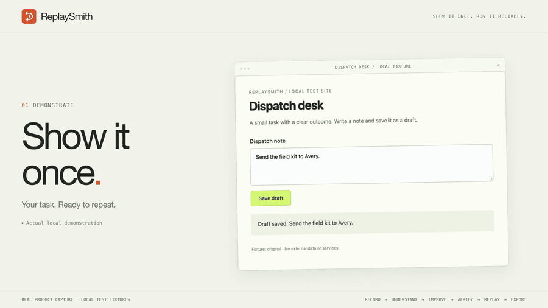
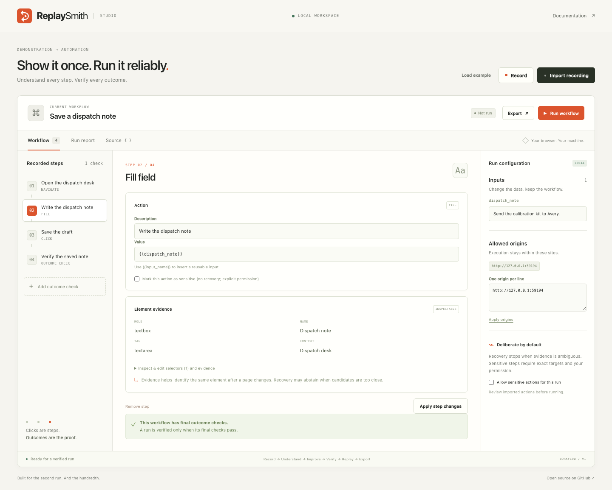
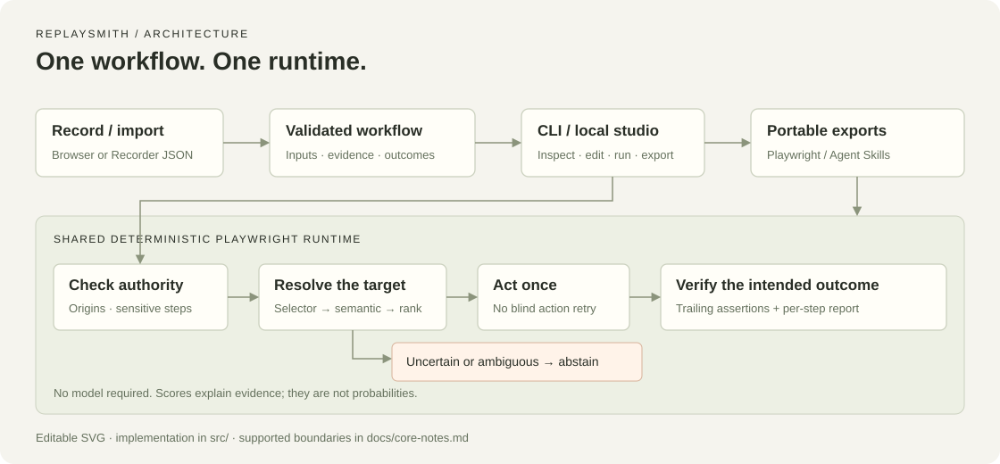

# ReplaySmith

**Record a browser task. Replay it with a checked outcome.**

Turn a demonstration into an editable workflow with inputs, bounded target recovery and an explicit result check. Inspect each decision, then export the behavior as Playwright code or an Agent Skill. Runs locally without a model or API key.



[Try the local example](#try-it-in-two-minutes) · [Download](https://github.com/nazeeh111/ReplaySmith/releases/latest) · [Workflow guide](docs/workflows.md) · [Benchmarks](docs/benchmarks.md) · [Prior art](docs/research.md) · [Contribute](CONTRIBUTING.md)

## Try it in two minutes

Requires **Node.js 22+** on macOS, Linux, or Windows. The release contains the built CLI and studio; you do not need a compiler.

```sh
npm install --global https://github.com/nazeeh111/ReplaySmith/releases/download/v0.1.1/replaysmith-0.1.1.tgz
replaysmith install-browser
replaysmith studio
```

Open the printed loopback URL, usually `http://127.0.0.1:3333`. The example is a real local form with a saved-note assertion. Change the **note** input and choose **Run workflow**. The report distinguishes actions completing from an outcome being verified.

On Linux, install Chromium's OS libraries with `npx playwright install --with-deps chromium` if the browser installer reports missing dependencies. Release packages are hosted on GitHub; this project is not published to the npm registry.

Prefer source?

```sh
git clone https://github.com/nazeeh111/ReplaySmith.git
cd ReplaySmith
npm ci
npx playwright install chromium
npm run studio
```

## Demonstration → dependable replay

1. **Record or import.** Demonstrate in a fresh Chromium window, or import Chrome DevTools Recorder JSON. Captured form values become named input defaults automatically. Unsupported import operations fail visibly.
2. **Understand and improve.** Inspect every step, locator, fingerprint, origin, and input. Edit the workflow in the studio or as versioned JSON. Mark consequential actions as sensitive.
3. **Verify and replay.** Add a final text, value, URL, or visibility check that expresses the intended result. Run with new inputs; inspect failures, abstentions, and candidate evidence.
4. **Export.** Download executable Playwright JavaScript or a directory-compatible Agent Skill. The export embeds the same guards, scorer, and outcome checks.

Use **Assert text** while recording to capture a result, then **Stop & review**. Recording is one tab, one origin, with a clean browser profile. It does not attach to your normal signed-in browser.



## Built for the second run

A selector can still match after it has become the wrong target. ReplaySmith checks its available semantic evidence before acting. If that selector no longer fits, it tries exact semantic locators, then ranks visible candidates using role, name, label, input type, test ID, text, and named surrounding context.

- **Inspectable recovery.** Candidate scores include the evidence that contributed. Recovery requires a score of at least `0.78` and a lead of `0.12`. These are deterministic heuristics, not probabilities or a trained model.
- **Permission before consequential actions.** Marked sensitive actions, detected consequential targets, and form submissions require explicit permission and a matching recorded selector. They never use recovery.
- **A safe stopping point.** Weak, missing, disabled, or ambiguous targets cause abstention. A failed outcome does not repeat the preceding click.
- **Portable behavior.** Generated Playwright and Agent Skill scripts run without ReplaySmith and retain its safety and verification logic.

Semantic locators and self-healing automation already exist. ReplaySmith's focus is a small, editable artifact and a bounded local resolver whose decision you can inspect. See the [primary-source research](docs/research.md) for comparisons with Playwright, Puppeteer Replay, workflow-use, Browser Use, Stagehand, and others.

## CLI that stays out of the way

```sh
# With the studio running, use the local example
replaysmith example -o dispatch.json
replaysmith run dispatch.json --input note='Ship the calibration kit to Avery.' --report run.json

# Import a supported Chrome Recorder JSON file and inspect the generated inputs
replaysmith import recording.json -o task.json
replaysmith inspect task.json

# Or record directly in a fresh browser
replaysmith record https://example.org -o recorded.json

# Export a frozen executable or an Agent Skill directory
replaysmith export task.json --format playwright -o workflow.mjs
replaysmith export task.json --format skill -o exported-skills
```

Output paths must be new; existing files are never silently overwritten. Run exit codes are `0` for a verified outcome, `2` for abstention or an unverified run, and `1` for failure or invalid input. Secret runtime inputs can be passed as JSON through `--inputs-stdin`. Slower pages can use `--timeout-ms 15000` with CLI replay or either exported script (default 5000 ms; range 100–60000).

The [workflow guide](docs/workflows.md) covers input preparation, meaningful assertions, sensitive actions, reports, and exports. [Example workflows](examples/) include an ordinary run, changed IDs, and a reused-ID trap on the local demo page.

## Tested on public websites

The v0.1.1 fixes were exercised on TodoMVC, Books to Scrape, The Internet, and the production Python and Playwright documentation sites. Native recordings, changed inputs, actual page outcomes, controlled local DOM changes, and both executable export formats are checked. See the [live-site report](docs/real-websites.md) for exact tasks, evidence, and limits.

From a source checkout:

```sh
npm run test:live
# Or preserve a named, new output directory
npm run test:live -- --out artifacts/live-web/my-run
```

This is an explicit network smoke test, separate from deterministic CI. It uses fresh browser profiles and read-only or browser-local tasks. External changes or outages fail the run rather than being counted as successes. Recovery mutations affect only the isolated browser DOM or recorded selectors, not the hosted websites.

## Measured, with limits

<p align="center">
  <a href="https://github.com/nazeeh111/ReplaySmith/actions/workflows/ci.yml"></a>
  <a href="https://github.com/nazeeh111/ReplaySmith/releases"></a>
  <a href="LICENSE"></a>
  
</p>

The [published benchmark](docs/benchmarks.md) uses **11 controlled local scenarios, four policies, and three repetitions: 132 real Chromium trials**. It reads the fixture's actual saved value and wrong-action counters independently of the run report. Every policy uses the normal 5000 ms operation budget; semantic playback is an ordinary exact Playwright locator baseline. An earlier 900 ms run is preserved and explained in the report.

| Policy | Changed tasks completed | Wrong-action trials | Safe stops on refusal cases |
| --- | ---: | ---: | ---: |
| Recorded selectors | 0 / 15 | 3 / 33 | 12 / 12 |
| Exact semantic locators | 12 / 15 | 0 / 33 | 12 / 12 |
| First-match text heuristic | 12 / 15 | 6 / 33 | 6 / 12 |
| ReplaySmith | 15 / 15 | 0 / 33 | 12 / 12 |

ReplaySmith explicitly abstained in all 12 refusal trials and rejected the corrupted outcome in all three trials. Baseline safe stops include strict-locator errors and timeouts; these are safety successes too. The simple heuristic sometimes clicked a decoy, which the wrong-action metric exposes even when click execution succeeds. Completion alone is insufficient.

This developer-authored suite is synthetic, small, and not held out. It demonstrates these supported mutations, not arbitrary website reliability or superiority over complete competitor products. It also publishes timing overhead: the guarded resolver is generally slower than an exact locator on the unchanged fixture. Read the [raw results](benchmarks/results.json), [method](docs/benchmarks.md), and [runner](benchmarks/run.ts).

```sh
npm test
npm run bench                       # three repetitions; writes fresh results
npm run bench -- --repetitions 1    # shorter local/CI check
```

## What v0.1 supports

Supports Chromium, native/ARIA element interactions, one-page workflows, explicit inputs, bounded semantic recovery, and exact outcome assertions. Chrome Recorder import supports navigation, primary element clicks, changes, simple key presses, and navigation assertions.

It does not support frames, multiple tabs, file transfers, drag-and-drop, shadow-host selector chains, arbitrary JavaScript imports, or arbitrary synonym/redesign recovery. HTTP navigation redirects are blocked in this release. Accessible-name evidence is an approximation, not the complete WAI-ARIA algorithm. See [core boundaries](docs/core-notes.md).

Workflows are executable instructions. Review them and their origin list before running. Origin checks constrain navigation; page scripts and subresources can still make other network requests. Automatic sensitive detection and secret masking are aids, not complete classifiers. See [SECURITY.md](SECURITY.md) before handling private or consequential tasks.

## Under the hood



One TypeScript/Node library, Playwright, and a dependency-free studio. No second browser framework, database, orchestration platform, model download, or custom ML. The [architecture note](docs/architecture.md) maps the diagram to source modules. The [launch composition](demo/) and [capture script](scripts/capture-demo.ts) preserve how the demo was made.

MIT licensed. Reproducible bug reports and focused changes are welcome through [issues](https://github.com/nazeeh111/ReplaySmith/issues) and [contributions](CONTRIBUTING.md).
